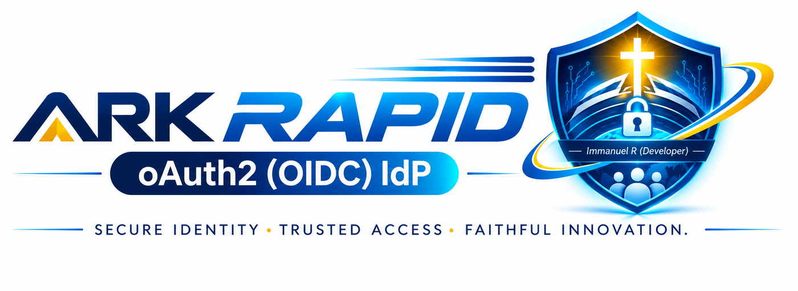
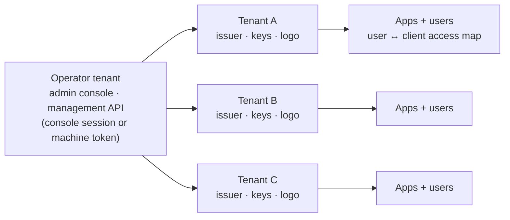

<!--
  README.md — ARK Identity Server (repository root)
  Audience: AI coding agents first, the humans who drive them second.
  Source of truth: the code. Where this file and the source disagree, the source wins — say so.
  Machine-readable digest of this file: https://ir-dev.github.io/ark-oauth-oidc/llms.txt (site/llms.txt)
-->

<p align="center">
  <picture>
    <source media="(prefers-color-scheme: dark)" srcset="site/assets/img/ark-banner-dark.png">
    
  </picture>
</p>

<h1 align="center">ARK Identity Server</h1>

<p align="center">
  <b>Your own OAuth 2.1 / OpenID Connect identity provider in two lines of C#.<br>
  Sign-in for any app with two settings. Every tenant governed from one console.</b>
</p>

<p align="center">
  <a href="https://github.com/ir-dev/ark-oauth-oidc/actions/workflows/release.yml"></a>
  <a href="https://github.com/ir-dev/ark-oauth-oidc/releases/latest"></a>
  <a href="https://ir-dev.github.io/ark-oauth-oidc/"></a>
  <a href="https://www.nuget.org/packages/Ark.oAuth.Oidc"></a>
  <a href="https://www.nuget.org/packages/Ark.oAuth.Client"></a>
  <a href="https://pypi.org/project/ark-oauth-client/"></a>
  <a href="https://www.npmjs.com/package/ark-oauth-client"></a>
  <a href="LICENSE"></a>
</p>

<p align="center">
  <a href="https://ir-dev.github.io/ark-oauth-oidc/"><b>Project site</b></a> ·
  <a href="#-from-zero-to-signed-in-three-steps">Three-step start</a> ·
  <a href="#-govern-every-tenant-and-every-instance">Govern</a> ·
  <a href="#0-for-ai-agents-read-this-first">For AI agents</a> ·
  <a href="https://ir-dev.github.io/ark-oauth-oidc/llms.txt">llms.txt</a> ·
  <a href="GETTINGSTARTED.md">Getting started</a>
</p>

A self-contained **OAuth 2.1 / OpenID Connect identity provider** for ASP.NET Core, plus **client
libraries for .NET, Python and Node** that are ports of each other. Multi-tenant; runs on SQLite, MySQL
or PostgreSQL; ships its own setup wizard, sign-in, consent and admin console. Any standard OIDC
library pointed at the issuer configures itself. The Ark clients just remove the boilerplate.

> **🤖 Coding agent?** This README is written for you. Read [§0](#0-for-ai-agents-read-this-first),
> then only the [scenario](#1-scenario-router) that matches your task. Each scenario has a paste-ready
> prompt, exact code, a **Done when** check and a **Do not** list. The whole contract also fits in one
> system prompt: [§4](#4-context-block-for-a-system-prompt).

---

## Why developers pick Ark

| The job | The usual way | With Ark |
|---|---|---|
| **Stand up an identity provider** | Choose a product, write its config, generate keys, seed a database, build or buy an admin UI | `builder.AddArkIdp()` + `app.UseArkIdp()`. A browser wizard collects the rest, and the same process becomes the IdP with **no restart** |
| **Add sign-in to an app** | Wire endpoints, keys, PKCE, `state`, `nonce`, refresh and logout by hand, per framework | **Two settings**, `authority` + `client_id`, in .NET, Python or Node. Everything else is discovered |
| **Register an app and give someone access** | Four admin steps in a fixed order. The forgotten fourth one reads as "wrong password" | **One call** or one form: client, redirect URIs, user and access mapping together |
| **Rotate signing keys** | Redeploy every client with the new public key | **Nothing to redeploy.** Clients read JWKS; rotation is two-phase |
| **Take access away now** | Delete the account, or wait days for tokens to expire | **One switch** per user or app. Sessions and refresh tokens are revoked at once |
| **Upgrade the database** | Hand-written `ALTER TABLE` per provider | **Applied at start-up** on SQLite, MySQL and PostgreSQL, recorded in `ark_schema_history` |
| **Back up, move or reset an instance** | Dump the database and hope the keys survive | **Encrypted export**, an import that shows its plan before it writes, and a factory reset that re-seeds |
| **Let a pipeline provision apps** | Share an admin password with CI | A **machine client** bearer token, with the secret from a vault. It is the only token the management API accepts |
| **Hand the work to an AI agent** | The agent guesses at OAuth and invents config keys | Each package ships `AI-PROMPT.md` and `AI-RECIPES.md`. This README routes the agent to the one scenario it needs |

**Secure by default, not by checklist:** PKCE `S256` is enforced and `plain` is refused. Codes and
refresh tokens are stored hashed. Replaying a refresh token revokes its whole family. Redirect URIs
are matched exactly. Sign-in failures can't be used to enumerate accounts. Implicit, hybrid and the
password grant are absent, as OAuth 2.1 requires.

---

## ⚡ From zero to signed-in: three steps

### Step 1 — Run the identity provider

```csharp
// Program.cs: the whole identity provider
using Ark.oAuth.Oidc;

var builder = WebApplication.CreateBuilder(args);
builder.AddArkIdp();          // no ark_oauth_server settings, no connection string
var app = builder.Build();
app.UseHttpsRedirection();
app.UseArkIdp();              // routing, CORS, wizard, bootstrap, auth, endpoints, in order
app.Run();
```

Run it and open the site. Every page leads to the **setup wizard** at `/ark-idp/setup`:

| Wizard step | What it captures |
|---|---|
| Organization & branding | names, website / terms / privacy URLs, your logo and a default app logo, with a live sign-in preview |
| Server address | public URL, operator tenant, base path. It shows the issuer and discovery URL it will produce |
| Database | SQLite, PostgreSQL or MySQL, with **Test connection**. An existing Ark database is attached, not re-seeded |
| Signing key | generate RSA 2048 / 3072 / 4096, or import a PEM |
| Administrator | username, name, password (with a generator) |
| Users & email | how new users get a first password; SMTP with **Send test** |
| Protocol & security | device flow, PAR, dynamic registration, consent, back-channel logout, lockout, CORS, machine secret |
| Review & install | one page, then **Install**. The same process is the IdP, with no restart |

From a remote machine the wizard asks for a **setup code** printed in the start-up log, so an
unconfigured server is not a race to the first visitor. Secrets go only into the database, hashed
where they can be, and never into the settings file. A host that already has `TenantId` and a
connection string never sees the wizard: that is the pipeline route, [S8](#s8--stand-up-the-identity-provider).

> **Release status.** `AddArkIdp()` / `UseArkIdp()`, the wizard and the appearance picker are on `main`.
> They arrived after v2.1.2 and ship in the next release. Until then:
> `dotnet run --project Ark.oAuth.Oidc/Ark.oAuth.Oidc.QuickStart` and open <https://localhost:7300>.
> The configured route, `AddArkOidcServer`, is released. To see a whole working setup from a fresh
> clone, run `./run.sh` (macOS/Linux) or `run.bat` (Windows), as described in [GETTINGSTARTED.md](GETTINGSTARTED.md).

### Step 2 — Onboard the app: one call

```bash
curl -X POST https://idp.example.com/api/oauth/v1/provision/client \
  -H "Authorization: Bearer $ARK_OPERATOR_TOKEN" -H 'Content-Type: application/json' \
  -d '{ "client_name": "Billing Portal", "user_name": "jane@example.com",
        "redirect_uris": ["https://billing.example.com/signin-oidc"],
        "post_logout_redirect_uris": ["https://billing.example.com/signout-callback-oidc"] }'
```

The call creates the client, registers both redirect URIs byte for byte, creates the user (or reuses
an existing account) and **maps the user to the client**. That last step is the one people forget;
without it, sign-in fails exactly like a wrong password. An operator who prefers a form can do the
same at `/{tenant}/admin/provisioning`, and the page then shows the equivalent `curl`. Details: [S9](#s9--onboard-an-application-client--user--access).

### Step 3 — Sign users in: two settings, three languages

| Language | Install |
|---|---|
| .NET / ASP.NET Core | `dotnet add package Ark.oAuth.Client` |
| Python / Flask | `pip install "ark-oauth-client[flask]"` |
| Node / Express | `npm install ark-oauth-client` |

```csharp
// .NET: "ark_oauth_client": { "Authority": "https://idp.example.com/my_idp", "ClientId": "billing_portal" }
builder.Services.AddArkOidcClient(builder.Configuration);
app.UseRouting(); app.UseAuthentication(); app.UseAuthorization();   // in this order
```

```python
# Python
auth = add_ark_oidc_client(app, {"authority": "https://idp.example.com/my_idp", "client_id": "billing_portal"})

@app.get("/billing")
@auth.require_claims("billing.admin")      # Ark claims, not scopes
def billing(): return current_ark.user["name"]
```

```js
// Node
const auth = arkExpress({ authority, clientId, redirectUri, secret: process.env.ARK_SESSION_SECRET });
app.use(auth);
app.get('/billing', auth.requireClaims('billing.admin'), handler);
```

**Done when:** an anonymous visit to a protected page lands on the IdP's sign-in. Signing in returns
the user to that page with their Ark claims, and sign-out followed by sign-in shows the login form,
not a silent sign-in. Endpoints and signing keys came from discovery, so a key rotation needs no
redeploy. Full scenarios: [S1 .NET](#s1--sign-users-in-to-an-aspnet-core-app) ·
[S2 Python](#s2--sign-users-in-to-a-python-app) · [S3 Node](#s3--sign-users-in-to-a-node-app).

---

## 🔐 Govern every tenant and every instance

Ark is **multi-tenant at the protocol layer**: each tenant is its own issuer at `{BaseUrl}/{TenantId}`,
with its own RSA signing key, discovery document, JWKS and branding. **Administration is
single-operator**: the operator tenant you chose in the wizard administers every tenant, from one console
and one API.



| You need to… | In the console | Over the API (`/api/oauth/v1/…`) | What it guarantees |
|---|---|---|---|
| Add a tenant | Tenants grid | `tenant/upsert` | Its own issuer and signing key |
| Onboard an app with its first user | Provisioning page | `provision/client` | All four steps or nothing. A taken name is `409 client_exists` with nothing written |
| Give an existing app another user | Provisioning page | `provision/user` | An existing account is never modified, only mapped |
| Switch a user or an app off | Activation panel | `activation/user`, `activation/client` | Sessions and refresh tokens are revoked at once; the sign-in page says which was switched off, but only after the password verifies |
| Change who may do what in an app | Users → access mapping | `user/client/claims/upsert` | Apps authorize on these `ark_claims`, not on scopes |
| Let a pipeline do all of the above | Clients → `{TenantId}_machine` → Regenerate secret | `client_credentials` token with `client.register` | Only the operator's machine client is admitted; others get `401`/`403` JSON, never a sign-in page |
| Back up an instance | Data page | `data/export` | Every table, keys included, as one file, optionally AES-256-GCM encrypted, with a checksum |
| Restore or move to another instance | Data page | `data/import/analyze` → `data/import/apply` | You choose `replace`, `merge_skip` or `merge_overwrite` from a row-by-row plan. Unsafe rows are excluded by named rules; the rest loads in one transaction |
| Start over | Data page | `data/reset` | Re-runs the first-run seed, and refuses if no administrator password is configured |
| Upgrade | — | automatic at start-up | Pending scripts run once and are recorded; missing tables and columns are added from the entity model on every provider |
| Prove what happened | — | audit rows | Every export, import and reset is audited, whatever the trace setting |

**Running more than one instance** follows from the same design. Every instance runs the same
self-applying bootstrap, so a rolling upgrade needs no migration step. Configuration comes from the
environment or a key vault (`ark_oauth_server__…`), so instances are identical. Move from SQLite to
`postgres` or `mysql` once there is more than one writer. To promote, clone or recover, use an
encrypted export from one instance and an analysed import into the other.

```bash
# A pipeline governs Ark without a human in the loop. The secret comes from your vault, never a file.
TOKEN=$(curl -s -X POST https://idp.example.com/my_idp/oauth2/token \
  -d grant_type=client_credentials -d client_id=my_idp_machine \
  --data-urlencode client_secret="$ARK_MACHINE_SECRET" -d scope=client.register | jq -r .access_token)

curl -s -H "Authorization: Bearer $TOKEN" https://idp.example.com/api/oauth/v1/client/list
curl -s -X POST -H "Authorization: Bearer $TOKEN" -H 'Content-Type: application/json' \
  https://idp.example.com/api/oauth/v1/activation/user -d '{ "user_name": "leaver@example.com", "is_active": false }'
```

Every IdP page (sign-in, consent, console and wizard) carries an **Appearance** picker with 11 themes
including high contrast, plus text size from 80 to 160%. Sign-in pages show the host's logo and the
client's own logo, so users can see who is asking for the password. Full governance scenario:
[S10](#s10--govern-tenants-access-and-instances).

---

## How this README is organised

**The rest of this README is written for AI coding agents.** It is organised by *scenario*: find the task you were
given, copy its prompt, follow its steps, check its "done when". The protocol reference sits at the end
as facts to cite, not prose to read.

| You are… | Do this |
|---|---|
| **A human** with an agent (Claude Code, Copilot, Cursor, Codex…) | Find your task in the [scenario router](#1-scenario-router), copy its **Prompt** block into your agent, fill the `<placeholders>`. |
| **An AI agent** | Read [§0](#0-for-ai-agents-read-this-first) in full, then only the one scenario that matches the task. For a compact digest, fetch [`llms.txt`](https://ir-dev.github.io/ark-oauth-oidc/llms.txt). |
| **A human, new, no agent** | Start with [GETTINGSTARTED.md](GETTINGSTARTED.md): `./run.sh` (macOS/Linux) or `run.bat` (Windows) takes a fresh clone to a working sign-in. |

---

## Contents

- [Why developers pick Ark](#why-developers-pick-ark)
- [⚡ From zero to signed-in: three steps](#-from-zero-to-signed-in-three-steps)
- [🔐 Govern every tenant and every instance](#-govern-every-tenant-and-every-instance)
- [0. For AI agents: read this first](#0-for-ai-agents-read-this-first)
- [1. Scenario router](#1-scenario-router)
- [2. Scenarios](#2-scenarios)
  - [S1 Sign users in — ASP.NET Core](#s1--sign-users-in-to-an-aspnet-core-app)
  - [S2 Sign users in — Python](#s2--sign-users-in-to-a-python-app)
  - [S3 Sign users in — Node](#s3--sign-users-in-to-a-node-app)
  - [S4 Browser SPA / native public client](#s4--browser-spa-or-native-public-client)
  - [S5 Protect an API](#s5--protect-an-api-resource-server)
  - [S6 Machine-to-machine](#s6--machine-to-machine-client-credentials)
  - [S7 Device / CLI sign-in](#s7--device-or-cli-sign-in-device-grant)
  - [S8 Stand up the identity provider](#s8--stand-up-the-identity-provider)
  - [S9 Onboard an application](#s9--onboard-an-application-client--user--access)
  - [S10 Govern tenants, access and instances](#s10--govern-tenants-access-and-instances)
  - [S11 Shared browser, wrong account](#s11--shared-browser-wrong-account)
  - [S12 Diagnose a failing sign-in](#s12--diagnose-a-failing-sign-in)
  - [S13 Migrate from v1](#s13--migrate-from-the-v1-client-or-endpoints)
  - [S14 Go to production](#s14--go-to-production)
  - [S15 Change this repository](#s15--change-this-repository)
- [3. Reference](#3-reference)
- [4. Context block for a system prompt](#4-context-block-for-a-system-prompt)

---

## 0. For AI agents: read this first

### Ground rules — apply to every scenario

```text
1. NEVER hand-roll OAuth/OIDC. Use the published package for the language (table below). They do
   PKCE, state, nonce, iss, at_hash, JWKS rotation and refresh; a hand-written flow will miss one.
2. NEVER invent an API, config key, endpoint or route. If it is not in this file or the package's
   AI-PROMPT.md, read the source before using it. If you still cannot find it, say so — do not guess.
3. Only TWO client settings are required: the authority (issuer = {BaseUrl}/{TenantId}, the tenant
   segment INCLUDED) and the client_id. Every endpoint and signing key comes from
   {authority}/.well-known/openid-configuration. Never hard-code endpoint URLs or paste a public key.
4. NEVER recreate the v1 client shape: a pasted rsaPublic key, a custom callback route, no
   state/nonce validation. That is what this repo replaced.
5. This repository is PUBLIC. Never write a secret, token, key or password into a tracked file,
   test, example, runbook or commit message. Secrets come from env vars / user-secrets / a vault.
6. Authorize on Ark claims (ark_claims in the access token), not on OAuth scopes. Scopes say what
   the CLIENT may ask for; ark_claims say what the USER may do in this app.
7. Read the access token per request; never cache it. The library refreshes it underneath you.
8. The provider side of an integration is not optional. Code alone never works: the client must
   be registered, both redirect URIs registered byte-for-byte, the scopes whitelisted, and the
   USER MAPPED TO THE CLIENT. Tell the human exactly which of these you could not do yourself.
9. Preserve the host app's architecture. These packages add authentication wiring; they do not
   want a restructured app.
10. Do not commit, publish or deploy unless explicitly asked. Leave changes as local edits.
```

### The four facts that cost the most time

| Symptom | Real cause | Fix |
|---|---|---|
| Sign-in fails with what reads exactly like **a wrong password** | The user is not mapped to the client. Ark maps users to clients explicitly. | Add the access mapping ([S9](#s9--onboard-an-application-client--user--access)). |
| `invalid_request` / redirect URI error | Redirect URIs are matched **byte for byte** — scheme, host, port, path, trailing slash. | Register **both** `/signin-oidc` and `/signout-callback-oidc` exactly as the app sends them. |
| `invalid_scope` | Scopes on a client record are a **whitelist**; an unregistered scope is rejected, not dropped. | Register the scope, or stop requesting it. `offline_access` is what earns a refresh token. |
| On a shared machine the next person is **signed in as the previous one**, then stuck on "no access" | SSO answered silently; the sign-in link returns to the same IdP session. | Turn on the account switch ([S11](#s11--shared-browser-wrong-account)). Off by default. |

### Repository map and where each agent should read next

| Path | What it is | Ships as | Agent docs beside it |
|---|---|---|---|
| [`Ark.oAuth.Oidc/Ark.oAuth.Oidc`](Ark.oAuth.Oidc/Ark.oAuth.Oidc) | The IdP / authorization server | NuGet `Ark.oAuth.Oidc` | `AI-PROMPT.md` `AI-RECIPES.md` `API-GUIDE.md` `TROUBLESHOOTING.md` `MIGRATION.md` |
| [`Ark.oAuth.Oidc/Ark.oAuth.Client`](Ark.oAuth.Oidc/Ark.oAuth.Client) | ASP.NET Core client | NuGet `Ark.oAuth.Client` | same five |
| [`ark_oauth_client_py`](ark_oauth_client_py) | Python client (Flask + framework-agnostic) | PyPI `ark-oauth-client` | same five, plus `examples/` |
| [`ark_oauth_client_nodejs`](ark_oauth_client_nodejs) | Node client (Express / Connect) | npm `ark-oauth-client` | `README.md`, `examples/`, `types/` |
| [`Ark.oAuth.Oidc/Ark.Client.Web`](Ark.oAuth.Oidc/Ark.Client.Web) | Reference client app — **the shape to copy** | not published | `README.md` |
| [`Ark.oAuth.Oidc/Ark.oAuth.Oidc.QuickStart`](Ark.oAuth.Oidc/Ark.oAuth.Oidc.QuickStart) | Zero-config IdP host: `AddArkIdp()` + `UseArkIdp()`, wizard on first run | not published | — |
| [`Ark.oAuth.Oidc/Ark.oAuth.Oidc.Host`](Ark.oAuth.Oidc/Ark.oAuth.Oidc.Host) | IdP host configured through appsettings | not published | — |
| [`site/`](site) | The project site (GitHub Pages) and [`llms.txt`](site/llms.txt) | Pages | `README.md` |

Reading order inside a package: **`AI-PROMPT.md`** (rules, capability map, decision guide) →
**`AI-RECIPES.md`** (task-shaped code) → **`API-GUIDE.md`** (full surface) → **`TROUBLESHOOTING.md`**
(symptom → cause) → **`MIGRATION.md`** (versions). The source under each package is authoritative over
all of them.

The three client packages are **ports of each other** and carry **one version number**: an
integration written in one translates almost line for line into another. All three ship the account
switch ([S11](#s11--shared-browser-wrong-account)), the setup probe, bearer protection and the
machine-to-machine helpers. Their names differ only by language convention (`RequireArkClaims` /
`require_ark_claims` / `requireArkClaims`).

### How to work in this repo as an agent

| Signal | Where |
|---|---|
| The whole contract in one paste | [§4 Context block](#4-context-block-for-a-system-prompt) |
| A fetchable digest, for tools that read `llms.txt` | <https://ir-dev.github.io/ark-oauth-oidc/llms.txt> ([source](site/llms.txt)) |
| Repo rules for editing this code (Claude Code reads it automatically) | [`CLAUDE.md`](CLAUDE.md) |
| A paste-ready prompt, steps, **Done when** and **Do not** for each task | [§2 Scenarios](#2-scenarios) |
| Ground truth when docs and code disagree | the source; say which one you followed |

---

## 1. Scenario router

| If the task is… | Scenario | Package / component |
|---|---|---|
| "Add login to my ASP.NET Core / MVC / Razor app" | [S1](#s1--sign-users-in-to-an-aspnet-core-app) | `Ark.oAuth.Client` |
| "Add login to my Flask / Django / FastAPI app" | [S2](#s2--sign-users-in-to-a-python-app) | `ark-oauth-client` (PyPI) |
| "Add login to my Express / Node app" | [S3](#s3--sign-users-in-to-a-node-app) | `ark-oauth-client` (npm) |
| "A React/Angular/Vue SPA, mobile or desktop app needs to sign in" | [S4](#s4--browser-spa-or-native-public-client) | IdP `CorsOrigins` + any OIDC library |
| "Protect my API with bearer tokens" | [S5](#s5--protect-an-api-resource-server) | any client package |
| "A service/job/cron needs a token with no user" | [S6](#s6--machine-to-machine-client-credentials) | client credentials |
| "A CLI, TV or headless device needs a user to sign in" | [S7](#s7--device-or-cli-sign-in-device-grant) | device grant |
| "Stand up / host / configure the identity server" | [S8](#s8--stand-up-the-identity-provider) | `Ark.oAuth.Oidc` |
| "Register a new app", "give a user access", "create a client" | [S9](#s9--onboard-an-application-client--user--access) | provisioning API / admin console |
| "Add a tenant", "switch a user off", "back up / restore / move / reset the IdP", "let CI manage it", "upgrade" | [S10](#s10--govern-tenants-access-and-instances) | management, activation and data tools APIs |
| "Users get each other's accounts on a shared PC", "stuck on no-access" | [S11](#s11--shared-browser-wrong-account) | account switch |
| "Login says wrong password but it isn't", "invalid_client", "redirect loop" | [S12](#s12--diagnose-a-failing-sign-in) | setup probe + troubleshooting |
| "This app pastes an `rsaPublic` key", "uses `/oauth/{t}/v1/…`" | [S13](#s13--migrate-from-the-v1-client-or-endpoints) | migration |
| "Make it production ready", "harden", "rotate keys" | [S14](#s14--go-to-production) | IdP + clients |
| "Fix a bug in / add a feature to one of the libraries in this repo" | [S15](#s15--change-this-repository) | this repo |

---

## 2. Scenarios

Every scenario has the same shape: **Use when** · **Prompt** (paste into your agent) · **Agent: read
first** · **Steps** · **Done when** · **Do not**.

---

### S1 — Sign users in to an ASP.NET Core app

**Use when:** an ASP.NET Core (`Microsoft.NET.Sdk.Web`, `net9.0`) app must sign users in against Ark.

**Prompt**

```text
Add Ark sign-in to this ASP.NET Core app using the Ark.oAuth.Client NuGet package. Do not hand-roll
OAuth. Authority is <https://idp.example.com/my_idp> and ClientId is <my-app>. Put both in the
"ark_oauth_client" config section; the client secret, if any, goes in user-secrets, not appsettings.
Call AddArkOidcClient(builder.Configuration), and make sure UseRouting() precedes UseAuthentication()
and UseAuthorization(). Protect <these pages> with [Authorize], and authorize <admin pages> with
[Authorize(Roles = "<ark claim>")]. Add a sign-out that signs out of BOTH ArkOidcClient.CookieScheme
and ArkOidcClient.OidcScheme. Do not add any route at /signin-oidc. Afterwards, list the exact
redirect URIs I must register on the IdP and remind me to map my user to the client.
```

**Agent: read first** — [`Ark.oAuth.Client/AI-PROMPT.md`](Ark.oAuth.Oidc/Ark.oAuth.Client/AI-PROMPT.md),
recipes 1–3 and 11 in [`AI-RECIPES.md`](Ark.oAuth.Oidc/Ark.oAuth.Client/AI-RECIPES.md), and
[`Ark.Client.Web`](Ark.oAuth.Oidc/Ark.Client.Web/README.md) as the complete working shape.

**Steps**

```bash
dotnet add package Ark.oAuth.Client
```

```csharp
using Ark.oAuth;                                            // root namespace is Ark.oAuth, not Ark.oAuth.Client

builder.Services.AddArkOidcClient(builder.Configuration);   // binds "ark_oauth_client"
var app = builder.Build();
app.UseRouting();                                           // MUST precede the next two
app.UseAuthentication();
app.UseAuthorization();
```

```jsonc
"ark_oauth_client": {
  "Authority": "https://idp.example.com/my_idp",            // {BaseUrl}/{TenantId}
  "ClientId": "my-app",
  "ClientSecret": null,                                     // set only for a confidential client, from a secret store
  "Scopes": ["openid", "profile", "email", "offline_access"],
  "CallbackPath": "/signin-oidc",
  "SignedOutCallbackPath": "/signout-callback-oidc",
  "RequireHttpsMetadata": true
}
```

```csharp
[Authorize(Roles = "billing.admin")]                        // ark_claims are projected as role claims
public IActionResult Billing() => View();

var token = await HttpContext.GetArkAccessTokenAsync();     // per request, never cached
await request.WithArkTokenAsync(HttpContext);               // or attach it to a downstream call
```

**Done when:** an anonymous request to an `[Authorize]` page redirects to the IdP; signing in returns
to that page; a role-protected page admits a user with that Ark claim and 403s one without; sign-out
followed by sign-in shows the IdP login form (not a silent sign-in).

**Do not:** add a route at `CallbackPath`; cache the token; mix `Microsoft.IdentityModel.*` versions
(a split graph fails only at runtime, on the first challenge, with a message naming none of this);
enable `UseLegacyFlow` in new code; set `RequireHttpsMetadata` false outside local http development.

---

### S2 — Sign users in to a Python app

**Use when:** a Flask app (or, via the protocol client, Django / FastAPI / a script) must sign users in.

**Prompt**

```text
Add Ark sign-in to this Flask app with the ark-oauth-client PyPI package (pip install
"ark-oauth-client[flask]"). Do not hand-roll OAuth. The entire integration is
auth = add_ark_oidc_client(app, {"authority": "<https://idp.example.com/my_idp>", "client_id": "<my-app>"}).
app.secret_key must come from an environment variable, be at least 16 characters, and be the same on
every instance. Protect <views> with @auth.require_auth() and <admin views> with
@auth.require_claims("<ark claim>"). Read tokens per request with current_ark.access_token(). Do not
define routes at /login, /signin-oidc, /logout or /ark/*. If the app runs on more than one instance,
pass a shared store=. Afterwards, list the redirect URIs I must register and remind me to map my user
to the client.
```

For a non-Flask framework, replace the middle of the prompt with: *"use `ArkOAuthClient` directly —
`create_authorization_url` to start, `handle_callback` to finish — and store state/nonce/code_verifier
server-side, never in a cookie or hidden field the user can read."*

**Agent: read first** — [`ark_oauth_client_py/AI-PROMPT.md`](ark_oauth_client_py/AI-PROMPT.md), recipes
1–3, 8 and 9 in [`AI-RECIPES.md`](ark_oauth_client_py/AI-RECIPES.md),
[`examples/web_app.py`](ark_oauth_client_py/examples/web_app.py).

**Steps**

```python
import os
from flask import Flask
from ark_oauth_client.flask import add_ark_oidc_client, current_ark

app = Flask(__name__)
app.secret_key = os.environ["ARK_SESSION_SECRET"]           # >= 16 chars, same on every instance
auth = add_ark_oidc_client(app, {
    "authority": "https://idp.example.com/my_idp",
    "client_id": "my-app",
})                                                          # serves /login /signin-oidc /logout /ark/*

@app.get("/billing")
@auth.require_claims("billing.admin")                       # Ark claims, not scopes
def billing():
    headers = current_ark.authorize({})                     # Bearer header for a downstream call
    return current_ark.user["name"]
```

**Done when:** the same four checks as S1 pass, and errors are handled by exception class
(`ArkConfigError`, `ArkOAuthError`, `ArkTokenError`, `ArkCallbackError`, `ArkNetworkError`), never by
message text.

**Do not:** use the default `MemorySessionStore` behind a load balancer (a callback that lands on
another instance fails with "could not be matched to a request"); discard what a refresh returns —
refresh tokens rotate and replaying a retired one revokes the whole family; use `ArkClientCredentials`
for a client registered with anything but `client_secret_post` (use `ArkOAuthClient.client_credentials`).

---

### S3 — Sign users in to a Node app

**Use when:** an Express / Connect (or `@fastify/middie`, `koa-connect`, bare `http`) app must sign users in.

**Prompt**

```text
Add Ark sign-in to this Node app with the ark-oauth-client npm package. Do not hand-roll OAuth.
Use arkExpress({ authority: "<https://idp.example.com/my_idp>", clientId: "<my-app>",
redirectUri: "<https://app.example.com/signin-oidc>", postLogoutRedirectUri: "<https://app.example.com/>",
secret: process.env.ARK_SESSION_SECRET }) and app.use(auth). Protect <routes> with auth.requireAuth()
and <admin routes> with auth.requireClaims("<ark claim>"). Read the token per request with
await req.ark.accessToken(). Do not add routes at /login, the callback path or /logout. If the app runs
on more than one instance, pass a shared store. Afterwards, list the redirect URIs I must register and
remind me to map my user to the client.
```

**Agent: read first** — [`ark_oauth_client_nodejs/README.md`](ark_oauth_client_nodejs/README.md) (it is
the only doc for Node), [`examples/express-app.js`](ark_oauth_client_nodejs/examples/express-app.js),
the typings in [`types/`](ark_oauth_client_nodejs/types).

**Steps**

```js
import express from 'express';
import { arkExpress } from 'ark-oauth-client';

const app = express();
const auth = arkExpress({
  authority: 'https://idp.example.com/my_idp',
  clientId: 'my-app',
  clientSecret: process.env.ARK_CLIENT_SECRET,             // omit for a public client
  redirectUri: 'https://app.example.com/signin-oidc',
  postLogoutRedirectUri: 'https://app.example.com/',
  secret: process.env.ARK_SESSION_SECRET                   // >= 16 chars, same on every instance
});
app.use(auth);                                             // serves /login, the callback, /logout
app.get('/billing', auth.requireClaims('billing.admin'), (req, res) => res.send(req.ark.user.name));
```

**Done when:** the S1 checks pass; a background `fetch` to a protected route gets `401` (not a redirect),
and a signed-in user missing a claim gets `403`.

**Do not:** set `requireHttps: false` or `cookie.secure: false` outside local http; give
`clientSecret` together with `tokenEndpointAuthMethod: 'none'` (construction refuses it); branch on
error message text — use the error classes exported from the package.

---

### S4 — Browser SPA or native public client

**Use when:** the code that redeems the authorization code runs on the user's device — SPA, mobile,
desktop — so it cannot keep a secret.

**Prompt**

```text
This <SPA / native app> signs in against Ark as a PUBLIC client: no client secret, authorization code
+ PKCE with S256 (plain is refused). Use a standard OIDC library (<oidc-client-ts / AppAuth / …>)
configured only with authority <https://idp.example.com/my_idp> and client_id <my-spa>; everything
else comes from discovery. Do not use the implicit or hybrid flow — Ark does not support them. On the
IdP, the SPA's exact origin must be added to ark_oauth_server:Oidc:CorsOrigins (no wildcards) and the
host must call app.UseArkOidcCors() between UseRouting() and UseAuthorization(). For a native app use
a loopback redirect URI (any port is accepted on loopback). Tell me what to register on the IdP.
```

**Agent: read first** — [§3 Browser clients and `CorsOrigins`](#browser-clients-and-corsorigins), the
`/flows/spa` example in [`Ark.Client.Web`](Ark.oAuth.Oidc/Ark.Client.Web/README.md#the-other-flows),
server recipe 5 in [`Ark.oAuth.Oidc/AI-RECIPES.md`](Ark.oAuth.Oidc/Ark.oAuth.Oidc/AI-RECIPES.md).
The client's generated setup page, `/{tenant}/oauth2/integrate/{client_id}`, prints working
`oidc-client-ts` config for that exact registration.

**Done when:** the token call from the browser succeeds without a CORS error, the client record has
`token_endpoint_auth_method: none`, and no secret exists anywhere in the shipped bundle.

**Do not:** put a client secret in browser or app code; ask for a wildcard origin; treat the access
token's contents as the app's authorization source of truth (it is for the API).

---

### S5 — Protect an API (resource server)

**Use when:** an HTTP API must accept Ark access tokens from callers.

**Prompt**

```text
Protect this API with bearer access tokens issued by Ark (authority <https://idp.example.com/my_idp>).
Use the Ark client package for this language — do not configure a static signing key; keys come from
the JWKS and rotate. Verify locally (no per-request call to the IdP), enforce the at+jwt token type
so an ID token cannot be presented instead, and check audience <my_idp_api> only if I gave one.
Require Ark claim <reports.read> on <routes>. Return 401 for a missing/invalid token and 403 for a
valid token without the claim.
```

**Agent: read first** — client recipe 4 in the package's `AI-RECIPES.md`.

**Steps**

```csharp
// .NET
builder.Services.AddAuthentication().AddArkOidcApi(arkConfig);
```

```python
# Python
bearer = add_ark_oidc_api(app, "/api", authority="https://idp.example.com/my_idp",
                          client_id="my-api", audience="my_idp_api")   # omit audience to skip the check
@app.get("/api/reports")
@bearer.require(claims=["reports.read"])
def reports(): ...
```

```js
// Node
const bearer = arkBearer({ authority, clientId: 'my-api', audience: 'my_idp_api' });
app.use('/api', bearer);
app.get('/api/reports', bearer.require({ claims: ['reports.read'] }), handler);
```

**Done when:** a token from the right tenant with the claim gets 200; no token gets 401; an ID token
gets 401; a token without the claim gets 403.

**Do not:** call introspection on every request when local verification will do; accept tokens from
another tenant's issuer.

---

### S6 — Machine-to-machine (client credentials)

**Use when:** a service, job or daemon calls an API as itself, with no user.

**Prompt**

```text
Get a machine-to-machine token from Ark with the client credentials grant, using the Ark client
package (.NET ArkClientCredentials.GetTokenAsync / Python ArkClientCredentials.get_token or
client.client_credentials / Node client.clientCredentials({ scopes })). The client id is <my-service>; read the
secret from <env var / vault>, never from source. Request scope <reports.read>. Use the package's
caching instead of my own. Remember a public client cannot use this grant.
```

**Agent: read first** — client recipe 9 (.NET) / 10–11 (Python) in `AI-RECIPES.md`; server recipe 6.

**Wire shape**

```bash
curl -X POST https://idp.example.com/my_idp/oauth2/token \
  -u 'my-service:<secret>' -d 'grant_type=client_credentials' -d 'scope=reports.read'
```

**Done when:** a token is obtained, cached until shortly before expiry, and accepted by the API from S5.

**Do not:** reuse a user-facing web client for this; log the secret or the token; use the seeded
`<tenant>_machine` client before an operator has given it a secret (it ships secret-less on purpose).

---

### S7 — Device or CLI sign-in (device grant)

**Use when:** a CLI, TV or headless device needs a *user's* token but has no usable browser.

**Prompt**

```text
Implement user sign-in for this <CLI / device> with the OAuth device authorization grant (RFC 8628)
using the Ark client package (Python client.device_authorization() + client.poll_device_token(...);
Node client.deviceAuthorization() + client.pollDeviceToken(...)). Show the user verification_uri_complete (and the
user_code), then poll at the returned interval, handling authorization_pending and slow_down.
Never poll faster than interval. Store the resulting refresh token securely and persist the new one
every time it rotates.
```

**Wire shape** — `POST /{tenant}/oauth2/device_authorization`, then poll `/oauth2/token` with
`grant_type=urn:ietf:params:oauth:grant-type:device_code`. See [Flows](#flows).

**Done when:** the user approves on another device and the CLI receives tokens without a restart.

**Do not:** open a local web server and run the code flow when the device grant was asked for; ignore
`slow_down`; keep using a refresh token after a refresh returned a new one.

---

### S8 — Stand up the identity provider

**Use when:** you need to *run* the IdP — a new host, or the sample in this repo.

**Prompt (run the sample)**

```text
Run the Ark sample end to end from this repo with ./run.sh (or run.bat on Windows) and follow
GETTINGSTARTED.md. Report each readiness check it prints, and for anything marked not ready, tell me
the exact registration that is missing. Do not put the administrator password in any tracked file.
```

**Prompt (new host from NuGet, zero-config)**

```text
Turn this ASP.NET Core app into an Ark identity provider with the Ark.oAuth.Oidc NuGet package and
nothing else: builder.AddArkIdp(); after Build, app.UseArkIdp(); app.Run(). Add no ark_oauth_server
settings and no Ark.oAuth.Client. Run it and tell me to open it in a browser: the setup wizard at
/ark-idp/setup collects the organization, logos, public URL, tenant, database, signing key,
administrator, email and protocol options, then makes the same process the IdP.
```

The whole of `Program.cs`:

```csharp
using Ark.oAuth.Oidc;

var builder = WebApplication.CreateBuilder(args);
builder.AddArkIdp();
var app = builder.Build();
app.UseHttpsRedirection();
app.UseArkIdp();
app.Run();
```

[`Ark.oAuth.Oidc.QuickStart`](Ark.oAuth.Oidc/Ark.oAuth.Oidc.QuickStart) is exactly this; `dotnet run`
it and open https://localhost:7300. How the wizard stores and protects what it collects:
[the server README](Ark.oAuth.Oidc/Ark.oAuth.Oidc/README.md#the-setup-wizard).

**Prompt (new host from NuGet, configured from appsettings, e.g. for a pipeline)**

```text
Turn this ASP.NET Core app into an Ark identity provider with the Ark.oAuth.Oidc and Ark.oAuth.Client
NuGet packages. In Program.cs: AddArkOidcServer(builder.Environment) and
AddArkOidcClient(builder.Configuration) (the admin console is itself a client). Pipeline order:
UseRouting(); UseArkOidcCors(); UseArkAuthData(); UseArkOidcClient(); UseAuthentication();
UseAuthorization(); then map controllers. Configure "ark_oauth_server" with TenantId <my_idp>,
BaseUrl <https://idp.example.com>, Provider <sqlite|mysql|postgres> and
ConnectionStrings:ArkAuthConnection. AdminUser:Password has no default: read it from user-secrets or
the env var ark_oauth_server__AdminUser__Password — never appsettings.json. Point Admin:SignOutUrl at
a route of the host that signs out of both the cookie and the OIDC scheme. Tell me the resulting
issuer and discovery URL.
```

**Agent: read first** — [`Ark.oAuth.Oidc/AI-PROMPT.md`](Ark.oAuth.Oidc/Ark.oAuth.Oidc/AI-PROMPT.md),
server recipe 1, [GETTINGSTARTED.md](GETTINGSTARTED.md).

**Steps**

```bash
dotnet new mvc -n MyIdp && cd MyIdp
dotnet add package Ark.oAuth.Oidc
dotnet add package Ark.oAuth.Client
```

```csharp
using Ark.oAuth;
using Ark.oAuth.Oidc;

builder.Services.AddArkOidcServer(builder.Environment);   // the identity provider
builder.Services.AddArkOidcClient(builder.Configuration); // the admin console is itself a client
builder.Services.AddControllersWithViews();

var app = builder.Build();
app.UseHttpsRedirection();
app.UseStaticFiles();
app.UseRouting();        // must come before UseAuthentication / UseAuthorization
app.UseArkOidcCors();    // only needed if SPA clients call the token endpoint from a browser
app.UseArkAuthData();    // database bootstrap, latched
app.UseArkOidcClient();
app.UseAuthentication();
app.UseAuthorization();
app.MapControllerRoute(name: "default", pattern: "{controller=Home}/{action=Index}/{id?}");
app.Run();
```

```jsonc
"ark_oauth_server": {
  "TenantId": "my_idp",                  // a client "<TenantId>_client" is created for the admin console
  "BaseUrl": "https://idp.example.com",
  "BasePath": "",                        // set if hosted under a sub-path
  "Provider": "sqlite",                  // sqlite (default) | mysql | postgres — NOT sqlserver
  "DefaultPw": "<initial password for new users — from a secret store>",
  "UserPasswordMode": "admin_managed",   // admin_managed | email_based | auto
  "AdminUser": { "Username": "admin", "Name": "Admin User" },   // Password: from user-secrets / env
  "Admin": { "SignOutUrl": "/Home/SignOutAll" }
},
"ConnectionStrings": { "ArkAuthConnection": "Data Source=./data/ark_auth.db" }
```

```bash
dotnet user-secrets set "ark_oauth_server:AdminUser:Password" "<a real password>"
mkdir -p data && dotnet run
```

On first run the server creates its schema, generates an RSA signing key **locally**, seeds the OIDC
scope catalogue, and creates the administrator. The `AdminUser` section is read **only** while the
database is created — changing it later renames nothing and resets no password. A value left as a
`<<placeholder>>` counts as unset; with no password configured the first request fails with a message
naming the setting and no database is created.

**Done when:** `https://idp.example.com/my_idp/.well-known/openid-configuration` returns an `issuer`
equal to `{BaseUrl}/{TenantId}`, `/.well-known/jwks.json` publishes a key, and the administrator can
sign in at `/my_idp/admin`.

**Do not:** select `Provider: "sqlserver"` (not wired); compile in or default the admin password;
re-enable implicit, hybrid or ROPC; serve anything before `UseArkAuthData()`; expect the console's Sign
out to drop the host cookie by itself.

---

### S9 — Onboard an application (client + user + access)

**Use when:** a new app needs a client record, its redirect URIs, and at least one user who can sign in.

**Prompt**

```text
Onboard <Billing Portal> on the Ark IdP at <https://idp.example.com> (tenant <my_idp>) in ONE call to
POST /api/oauth/v1/provision/client — it creates the client, registers redirect URIs, creates or
reuses the user, AND writes the user-client access mapping. Redirect URIs, byte for byte:
<https://billing.example.com/signin-oidc> and post-logout <https://billing.example.com/signout-callback-oidc>.
User: <jane@example.com>. Authenticate as the operator (console session, or a {tenant}_machine bearer
token with client.register). Do not write any token or secret into a file. Report client_id,
user_credential, mapping_created and setup_url from the response. A 409 client_exists means nothing
was written — stop and tell me; do not retry under another name.
```

To give an **existing** client a new user, the same prompt with `POST /api/oauth/v1/provision/user`
(`client_id`, `user_name`, optional `claims`); an existing account is never modified, only mapped.

**Agent: read first** — server recipe 2 and the provisioning tables in
[`Ark.oAuth.Oidc/API-GUIDE.md`](Ark.oAuth.Oidc/Ark.oAuth.Oidc/API-GUIDE.md). A human can do the same at
`/{tenant}/admin/provisioning`, which also writes the `curl` for them.

**Steps**

```http
POST /api/oauth/v1/provision/client
Authorization: Bearer <token>
Content-Type: application/json

{
  "client_name": "Billing Portal",
  "user_name":   "jane@example.com",
  "tenant_id":   "my_idp",
  "client_id":   "billing_portal",
  "redirect_uris": [ "https://billing.example.com/signin-oidc" ],
  "post_logout_redirect_uris": [ "https://billing.example.com/signout-callback-oidc" ],
  "claims": [ "sub", "name", "email", "email_verified" ],
  "send_activation_email": false
}
```

Responses: `200 {error:false, code:"provisioned", data:{…}}` or `409 {error:true, code:"client_exists"}`
(nothing written). `user_credential` is `default_password`, `activation_email` or `existing_account`.

**Done when:** the user signs in to the new app and lands on a page that sees their Ark claims; the
generated setup page `/{tenant}/oauth2/integrate/{client_id}` shows matching values.

**Do not:** do it as four manual steps and forget the access mapping; edit rows directly in the
database; register only one redirect URI.

---

### S10 — Govern tenants, access and instances

**Use when:** the task is operating the IdP rather than integrating with it: add a tenant, switch an
account or an application off, change what a user may do in an app, back up, restore, move or reset an
instance, let a pipeline do any of that, or upgrade.

**Prompt**

```text
Operate the Ark IdP at <https://idp.example.com> (operator tenant <my_idp>) through its management API
under /api/oauth/v1/ — never by editing database rows. Authenticate as the operator: the console
session, or a client_credentials token for <my_idp>_machine with scope client.register, whose secret
comes from <env var / vault> and is never written to a file or echoed. Task: <add tenant X | deactivate
user Y | grant claim Z on client C to user U | export a backup | import file F into this instance |
factory reset>. For an import, call data/import/analyze first, show me the plan for each mode
(replace, merge_skip, merge_overwrite) and the excluded rows, and apply only the mode I choose, passing
the plan_hash back. For a reset or a replace import, stop and ask me before applying. Report each
response's code and what changed.
```

**Agent: read first** — the governance sections of
[`Ark.oAuth.Oidc/README.md`](Ark.oAuth.Oidc/Ark.oAuth.Oidc/README.md#deactivating-a-user-or-a-client)
and the management, provisioning and data-tools tables in
[`API-GUIDE.md`](Ark.oAuth.Oidc/Ark.oAuth.Oidc/API-GUIDE.md#management-api-managecontroller-operator-policy-base-apioauth).

**Who may call it.** The operator's console session (the `AdminUser:Username` account, or an `admin`
claim on its console mapping), or a bearer token issued by the operator tenant to `{TenantId}_machine`
with `client.register`. Everything else gets `401`/`403` JSON. A token with `client.register` held by
any other client is refused. The machine client is seeded **without a secret**: give it one with
**Regenerate secret** in the console, or `ark_oauth_server:Management:MachineClientSecret` (≥ 16 chars)
from a vault, which is re-applied on every start and survives a database rebuild.

**Steps**

| Task | Call (`POST` unless marked) | Body / notes |
|---|---|---|
| List tenants / clients / users | `GET v1/tenant/list`, `v1/client/list`, `v1/user/list` | |
| Add or edit a tenant | `v1/tenant/upsert` | its own issuer `{BaseUrl}/{tenant_id}` and signing key |
| Onboard app + first user | `v1/provision/client` | [S9](#s9--onboard-an-application-client--user--access) |
| Another user for an existing app | `v1/provision/user` | `{ client_id, user_name, claims? }`; an existing account is only mapped |
| Grant / revoke an Ark claim | `v1/user/client/claims/upsert`, `…/delete` | the claims the app's `require_claims` checks |
| Switch a user off / on | `v1/activation/user` | `{ user_name, is_active, reason? }`; revokes sessions + refresh tokens |
| Switch an app off / on | `v1/activation/client` | `{ tenant_id, client_id, is_active }`; revokes its refresh tokens; refused at `/authorize` |
| Rotate a client secret | `v1/client/secret/reset` | shown once; refused for the machine client while `MachineClientSecret` is set |
| Back up | `v1/data/export` | `{ passphrase? }` → AES-256-GCM file + checksum. It contains private keys: store it like the database |
| Restore / move | `v1/data/import/analyze` → `v1/data/import/apply` | `{ file, passphrase? }`; analyse writes nothing; apply adds `mode` + `plan_hash` (and, for `replace`, `confirm` = the operator tenant id typed out) |
| Factory reset | `v1/data/reset` | `{ confirm: "<operator tenant id>" }`; empties every table and re-seeds; refuses if no admin password is configured |
| Summary before any data task | `GET v1/data/summary` | row counts, operator tenant, what is allowed |

Data tools can be switched off per capability under `ark_oauth_server:Admin:DataTools`
(`Enabled`, `AllowReset`, `AllowImport`, `AllowReplace`, `MaxImportMegabytes`). Upgrades need no call:
`UseArkAuthData()` / `UseArkIdp()` applies pending scripts once, records them in `ark_schema_history`,
then adds any table or column the entity model has and the database lacks, on every provider.

**Done when:** the API answered `error: false` (or the documented code) for each step, and the result is
visible. A deactivated user's next sign-in is refused, with the reason given only after a correct
password. An analysed import's plan matched what apply reported. A reset left a server the configured
administrator can sign in to.

**Do not:** edit database rows directly; give a pipeline the administrator's password instead of the
machine client; put `MachineClientSecret` or an export passphrase in a tracked file; apply a
`replace` import or a reset without the human's explicit go-ahead; expect deactivation to kill access
tokens already issued (they live until `exp`, an hour by default).

---

### S11 — Shared browser, wrong account

**Use when:** on a shared machine, SSO signs the next person in as the previous one, and the app's "no
access" page offers no way out because its sign-in link returns to the same IdP session.

**Both halves exist.** As of v2.1.2 the IdP itself no longer answers an authorize request from an SSO
session whose user is not mapped to that client: it sets the session aside and draws the sign-in
form with "You are signed in as X, who does not have access to <app>". The client half below is still
owed, because it is what turns an empty-handed sign-in into a page with a way out.

**Prompt**

```text
Enable the Ark account-switch fix in this app. It moves the entitlement check to the sign-in callback,
so no session is written for an account without the required ark_claims for this client, and serves a
built-in page at /ark/no-access that names the signed-in account and offers "Sign in as a different
user" (prompt=login). .NET: set ark_oauth_client:AccountSwitch:RequireArkClaims = true, plus
RequiredClaims and AppDisplayName; it self-registers, no Program.cs change. Python: in the configure
callback set options.config.account_switch.require_ark_claims = True and required_claims. Node: pass
accountSwitch: { requireArkClaims: true, requiredClaims: [...] } to arkExpress. Do not build a custom
"wrong account" page from scratch and do not echo an arbitrary returnUrl.
```

**Steps**

```jsonc
// .NET
"ark_oauth_client": { "AccountSwitch": {
  "RequireArkClaims": true, "RequiredClaims": ["billing.user", "billing.admin"], "AppDisplayName": "Billing Portal" } }
```

```python
# Python
def configure(options):
    options.config.account_switch.require_ark_claims = True
    options.config.account_switch.required_claims = ["billing.user", "billing.admin"]
    options.config.account_switch.app_display_name = "Billing Portal"
auth = add_ark_oidc_client(app, config, configure)
```

```js
// Node
const auth = arkExpress({ authority, clientId, redirectUri, secret,
  accountSwitch: { requireArkClaims: true, requiredClaims: ['billing.user', 'billing.admin'], appDisplayName: 'Billing Portal' } });
```

**Set `RequiredClaims`.** The server issues the user's whole mapping as `ark_claims`, identity names such
as `sub` and `email` included, so `RequireArkClaims` alone admits anyone who has *a* mapping to the
client. Naming the app's own claims makes the check mean "may use this app".

Kiosk variant: `EndProviderSessionOnSwitch` / `end_provider_session_on_switch` / `endProviderSessionOnSwitch`
ends the previous user's IdP session as well. Custom entitlement rules: the `OnEvaluateAccess` /
`onEvaluateAccess` event (client recipe 7).

**Done when:** an account without the required claims never gets a session cookie, lands on the
no-access page, and "Sign in as a different user" shows the IdP login form.

**Do not:** leave the user on a 403 that links back to `/login` (it loops through the same session); make
the switch an automatic redirect rather than a button (an unmapped next user would loop).

---

### S12 — Diagnose a failing sign-in

**Use when:** sign-in fails, loops, or reports an error that does not match reality.

**Prompt**

```text
Ark sign-in is failing with <exact error / page text / auth_error value>. Diagnose before changing
code. First run the setup probe (.NET ArkSetupProbe.ProbeAsync, Python auth.setup_model() or
client.check_setup(), Node examples/setup-check.js) and compare its output with the client record on
the IdP. Check, in order: (1) authority equals the discovery document's issuer exactly, tenant segment
included; (2) the redirect URI the app sends is registered byte for byte, and so is the post-logout
one; (3) every requested scope is whitelisted on the client; (4) the user is mapped to the client;
(5) the client and the user are active; (6) on .NET, all Microsoft.IdentityModel.* packages resolve
to one version. Tell me which check failed and the smallest fix. Do not weaken validation to make it pass.
```

**Symptom → cause**

| Symptom | Likely cause |
|---|---|
| "Wrong password" for a correct password | No user-client access mapping, or the user/client is deactivated |
| Error page at `/oauth2/authorize`, no redirect back | Redirect URI not registered exactly (the IdP will not redirect to an unvalidated URI) |
| `invalid_scope` | Scope not whitelisted on the client record |
| `invalid_client` | Wrong secret, wrong `token_endpoint_auth_method`, or a public client sending a secret |
| Issuer mismatch at startup | `Authority` missing the tenant segment, or `BaseUrl` differs (http vs https, port, sub-path) |
| .NET: "Cannot redirect to the authorization endpoint, the configuration may be missing or invalid" | Mixed `Microsoft.IdentityModel.*` versions |
| Python/Node: "could not be matched to a request" | Callback landed on another instance; use a shared session store |
| Signed out, next sign-in is silent | Only the local session was ended — sign out of the provider too |
| No refresh token | `offline_access` not requested or not whitelisted |

Deeper: each package's `TROUBLESHOOTING.md`, and [GETTINGSTARTED.md §9](GETTINGSTARTED.md#9-troubleshooting).

---

### S13 — Migrate from the v1 client or endpoints

**Use when:** an app pastes an `rsaPublic` key into config, uses `authServerUrl` + `tenantId`, has a
custom callback route, or calls `/oauth/{tenant}/v1/…`.

**Prompt**

```text
Migrate this app off the v1 Ark client shape. Remove the pasted rsaPublic key and the custom callback
route; replace them with the current Ark client package configured only with Authority
(= authServerUrl + "/" + tenantId) and ClientId, so keys come from jwks_uri and state/nonce are
validated. Map the old endpoints to the standard ones per the table in the README. Keep behaviour the
same for users. Do not leave UseLegacyFlow on at the end — it validates neither state nor nonce.
```

| v1 | Standard |
|---|---|
| Paste `rsaPublic` into config | Discovered from `jwks_uri` |
| `authServerUrl` + `tenantId` | `Authority` (the two joined) |
| `/oauth/{t}/v1/connect/authorize` | `/{t}/oauth2/authorize` |
| `/oauth/{t}/v1/token` | `/{t}/oauth2/token` |
| `/oauth/{t}/v1/.well-known/{c}/openid-configuration` | `/{t}/.well-known/openid-configuration` |
| Custom `redirect_relative` handling | Standard `CallbackPath` |

The v1 routes still answer, with their original shapes, but now delegate to the standard core — codes
are single-use, expire, and have their PKCE verifier checked. `ark_oauth_client:UseLegacyFlow = true`
keeps the old client middleware during a transition only. Schema changes self-apply on start-up via
`UseArkAuthData()`; see [`Ark.oAuth.Oidc/MIGRATION.md`](Ark.oAuth.Oidc/Ark.oAuth.Oidc/MIGRATION.md) for
databases that need manual steps. Client recipe 13 has the code.

**Done when:** no `rsaPublic` remains in config, no route exists at the callback path, and sign-in,
refresh and sign-out work with `UseLegacyFlow` off.

---

### S14 — Go to production

**Prompt**

```text
Review this Ark deployment for production. Check and report, item by item: AdminUser:Password set out
of band before first run (and changed after first sign-in); DefaultPw strong and not in source;
BaseUrl https; clients keep RequireHttpsMetadata/requireHttps on; EnableDynamicRegistration off unless
needed, RequireRegistrationAccessToken on if it is; confidential clients have real secrets and the
right token_endpoint_auth_method; the machine client has a per-deployment secret; CorsOrigins lists
only exact origins; Admin:SignOutUrl points at a host route that ends both sessions; session secrets
identical across instances with a shared session store; Microsoft.IdentityModel.* on one version.
Do not change anything without telling me what and why.
```

**Agent: read first** — server recipe 13, [§3 Security notes](#security-notes), [Key management](#key-management).

---

### S15 — Change this repository

**Use when:** the task is to fix or extend one of the libraries *in this repo*, not to use them.

**Prompt**

```text
Make <change> in the ark-oauth-oidc repository. The three client packages (.NET Ark.oAuth.Client,
Python ark_oauth_client_py, Node ark_oauth_client_nodejs) are ports of each other: say whether the
change is owed to the other two, and make it there too unless I say otherwise. Run the tests: pytest
in ark_oauth_client_py, npm test in ark_oauth_client_nodejs — both use a stub IdP that mirrors the
server's wire behaviour; prefer it to a live server. The .NET side has no automated tests; verify it
against a running Ark.oAuth.Oidc.Host and say so. Update the package's AI-PROMPT / AI-RECIPES /
API-GUIDE / TROUBLESHOOTING / MIGRATION if behaviour changes. Never commit a secret — this repo is
public. Do not commit, bump versions or publish unless I ask.
```

**Agent: read first** — [`CLAUDE.md`](CLAUDE.md) (repo rules), the package's `AI-PROMPT.md`.
Publishing has checked-in runbooks — [`nuget_deploy.txt`](nuget_deploy.txt) and
[`ark_oauth_client_py/pip_deploy.txt`](ark_oauth_client_py/pip_deploy.txt). Read them before any
release; versions are immutable on all three registries once pushed.

**Done when:** tests pass (state the counts), the docs beside the package match the new behaviour, and
the reply lists which ports were and were not changed.

---

## 3. Reference

Facts to cite. All protocol paths are relative to the issuer, `{BaseUrl}/{TenantId}`.

### What's supported

| Specification | Status |
|---|---|
| OAuth 2.0 Authorization Framework (RFC 6749) | Authorization code, refresh token, client credentials |
| PKCE (RFC 7636) | **Required** for public clients, `S256` only |
| OpenID Connect Core 1.0 | ID tokens, UserInfo, `nonce`, `at_hash`/`c_hash`, `auth_time`, `sid` |
| OpenID Connect Discovery 1.0 | `/.well-known/openid-configuration` |
| OAuth 2.0 Authorization Server Metadata (RFC 8414) | `/.well-known/oauth-authorization-server` |
| JSON Web Key Set (RFC 7517) | `/.well-known/jwks.json`, with two-phase key rotation |
| JWT Profile for Access Tokens (RFC 9068) | `typ: at+jwt`, `client_id`, `jti`, `scope` |
| Token Introspection (RFC 7662) | Access and refresh tokens |
| Token Revocation (RFC 7009) | Revokes the whole refresh-token family |
| Device Authorization Grant (RFC 8628) | With `verification_uri_complete` |
| Pushed Authorization Requests (RFC 9126) | Optional, can be made mandatory |
| Dynamic Client Registration (RFC 7591/7592) | Optional, off by default |
| RP-Initiated Logout 1.0 | `end_session_endpoint`, browser-wide by default |
| Back-Channel Logout 1.0 | Signed `logout_token` POSTed to each client that took part |
| Authorization Server Issuer Identification (RFC 9207) | `iss` in the authorization response |
| Native Apps (RFC 8252) | Loopback redirect URIs with variable ports |

**Deliberately not supported:** the implicit grant, the hybrid flow, and the resource owner password
credentials grant (all removed in OAuth 2.1); `plain` PKCE; front-channel logout (discovery reports
`frontchannel_logout_supported: false`).

### Endpoints

| Purpose | Path |
|---|---|
| Discovery | `/.well-known/openid-configuration` |
| Discovery (RFC 8414 name) | `/.well-known/oauth-authorization-server` |
| JWKS | `/.well-known/jwks.json` |
| Authorization | `/oauth2/authorize` |
| Token | `/oauth2/token` |
| UserInfo | `/oauth2/userinfo` |
| Introspection | `/oauth2/introspect` |
| Revocation | `/oauth2/revoke` |
| End session | `/oauth2/logout` |
| Device authorization | `/oauth2/device_authorization` |
| Device verification (user-facing) | `/oauth2/device` |
| Pushed authorization request | `/oauth2/par` |
| Dynamic registration | `/oauth2/register` |
| Client setup page | `/oauth2/integrate/{client_id}` |

Outside the issuer: setup wizard `/ark-idp/setup` (only while unconfigured; 404 afterwards), admin
console `/{tenant_id}/admin` (`/admin` redirects to the configured tenant), provisioning UI
`/{tenant_id}/admin/provisioning`, data tools `/{tenant_id}/admin/data`, management, provisioning,
activation and data API `/api/oauth/v1/…` (operator only).

### Flows

**Authorization code + PKCE** — the default for web, SPA and native apps.

```
GET /{tenant}/oauth2/authorize
      ?response_type=code&client_id=my-app
      &redirect_uri=https://app.example.com/signin-oidc
      &scope=openid%20profile%20email%20offline_access
      &state=<random>&nonce=<random>
      &code_challenge=<BASE64URL(SHA256(verifier))>&code_challenge_method=S256

POST /{tenant}/oauth2/token        (application/x-www-form-urlencoded)
grant_type=authorization_code&code=<code>&redirect_uri=https://app.example.com/signin-oidc
&client_id=my-app&code_verifier=<verifier>
```

```json
{ "access_token": "eyJ…", "token_type": "Bearer", "expires_in": 3600,
  "refresh_token": "…", "id_token": "eyJ…", "scope": "openid profile email offline_access" }
```

A `refresh_token` is issued only when `offline_access` is granted.

**Refresh token** — `grant_type=refresh_token&refresh_token=<token>&client_id=my-app`. Rotation is on
by default: each refresh returns a new refresh token and retires the old one. Presenting a used token
is treated as theft and **revokes the entire family**. Scope may be narrowed on refresh, never widened.

**Client credentials** — service to service; requires client authentication, so a public client
cannot use it. See [S6](#s6--machine-to-machine-client-credentials).

**Device authorization grant**

```bash
curl -X POST https://idp.example.com/my_idp/oauth2/device_authorization \
  -u 'my-device:<secret>' -d 'scope=openid profile'
```

```json
{ "device_code": "…", "user_code": "WDJB-MJHT",
  "verification_uri": "https://idp.example.com/my_idp/oauth2/device",
  "verification_uri_complete": "https://idp.example.com/my_idp/oauth2/device?user_code=WDJB-MJHT",
  "expires_in": 600, "interval": 5 }
```

Poll the token endpoint with `grant_type=urn:ietf:params:oauth:grant-type:device_code`: expect
`authorization_pending` until approval, and `slow_down` when polling faster than `interval`.

**Pushed authorization requests** — POST the authorization parameters to `/oauth2/par` with client
authentication, then send the browser to `/oauth2/authorize?client_id=my-app&request_uri=<request_uri>`.
`Oidc:RequirePushedAuthorizationRequests` rejects plain authorization requests entirely.

### Configuration reference — server (`ark_oauth_server`)

| Key | Default | Meaning |
|---|---|---|
| `TenantId` | — | Operator tenant; issuer is `{BaseUrl}/{TenantId}` |
| `BaseUrl` | — | Public base URL, https in production |
| `BasePath` | `""` | Sub-path the app is hosted under |
| `Provider` | `sqlite` | `sqlite` \| `mysql` \| `postgres` |
| `DefaultPw` | — | Initial password for new users |
| `UserPasswordMode` | — | `admin_managed` \| `email_based` (parks email accounts in reset mode, sends an activation link) \| `auto` (legacy, caller decides) |
| `AdminUser:Username` | `admin` | Login id of the seeded administrator; need not be an email |
| `AdminUser:Password` | **none** | Required; falls back to `DefaultPw`; a `<<placeholder>>` counts as unset; read only while the DB is created |
| `AdminUser:Name` | `Admin User` | Display name |
| `Admin:SignOutUrl` | `end_session_endpoint` | Where the console's **Sign out** link goes |
| `EmailConfig:*` | — | SMTP and branding for activation / reset mail |
| `ConnectionStrings:ArkAuthConnection` | — | Database connection string |

Under `ark_oauth_server:Oidc`, all optional:

| Key | Default | Meaning |
|---|---|---|
| `EnableDeviceFlow` | `true` | Serve the device grant |
| `EnablePushedAuthorizationRequests` | `true` | Serve `/oauth2/par` |
| `RequirePushedAuthorizationRequests` | `false` | Refuse requests that did not arrive via PAR |
| `EnableDynamicRegistration` | `false` | Serve `/oauth2/register` — it lets callers create clients |
| `RequireRegistrationAccessToken` | `true` | Require an initial access token to register |
| `AlwaysRequireConsent` | `false` | Show consent even for first-party clients |
| `SessionLifetimeMinutes` | `480` | IdP session lifetime |
| `MaxFailedSignIns` | `10` | Consecutive failures before lockout; `0` disables |
| `LockoutMinutes` | `15` | Lockout duration |
| `DeviceCodeLifetimeSeconds` | `600` | Device code validity |
| `DevicePollIntervalSeconds` | `5` | Minimum device polling interval |
| `ParLifetimeSeconds` | `90` | `request_uri` validity |
| `CorsOrigins` | `[]` | Exact browser origins allowed to call token, userinfo, discovery, JWKS |
| `EnableBackChannelLogout` | `true` | Notifies nobody until a client registers a URI |
| `BackChannelLogoutTimeoutSeconds` | `5` | Per client; deliveries run in parallel |
| `LogoutTokenLifetimeSeconds` | `120` | |
| `SignOutAllBrowserSessions` | `true` | Off ends only the session the cookie names |
| `SignOutAcrossTenants` | `true` | Off keeps a sign-out inside the tenant it was asked of |

Per-client settings live on the client record: `access_token_lifetime_seconds`,
`id_token_lifetime_seconds`, `refresh_token_lifetime_seconds`, `authorization_code_lifetime_seconds`,
`require_pkce`, `require_par`, `require_consent`, `refresh_token_rotation`,
`token_endpoint_auth_method` (`client_secret_basic` \| `client_secret_post` \| `private_key_jwt` \|
`none`) and `is_active`.

#### Browser clients and `CorsOrigins`

A SPA redeems its code from the browser, so the token endpoint is called cross-origin. Empty by
default — no cross-origin call succeeds. List exact origins (scheme, host, port; no wildcard, because
these endpoints hand out tokens):

```jsonc
"ark_oauth_server": { "Oidc": { "CorsOrigins": [ "https://app.example.com" ] } }
```

The policy covers only `/oauth2/token`, `/oauth2/userinfo`, discovery and JWKS, and never allows
credentials. The host enables it with `app.UseArkOidcCors()` between `UseRouting()` and
`UseAuthorization()`. Server-side clients need none of this.

### Configuration reference — clients

| .NET (`ark_oauth_client`) | Python | Node | Default |
|---|---|---|---|
| `Authority` | `authority` | `authority` | — required, `{BaseUrl}/{TenantId}` |
| `ClientId` | `client_id` | `clientId` | — required |
| `ClientSecret` | `client_secret` | `clientSecret` | `null` → public client + PKCE |
| `Scopes` | `scopes` | `scopes` | `openid profile email offline_access` |
| `CallbackPath` | `callback_path` | path of `redirectUri` | `/signin-oidc` |
| `SignedOutCallbackPath` | — | `postLogoutRedirectUri` | `/signout-callback-oidc` |
| `RoleClaimType` | `role_claim_type` | — | `role` |
| `RequireHttpsMetadata` | `require_https_metadata` | `requireHttps` | `true` |
| `AccountSwitch:RequireArkClaims` | `account_switch.require_ark_claims` | `accountSwitch.requireArkClaims` | `false` |
| `AccountSwitch:RequiredClaims` | `account_switch.required_claims` | `accountSwitch.requiredClaims` | any |
| `UseLegacyFlow` | `use_legacy_flow` (accepted, not implemented) | — | `false` |

Each package's `API-GUIDE.md` (Node: `README.md`) has the full list.

### Signing out

`end_session_endpoint` is `/{tenant_id}/oauth2/logout`.

- **It signs out the whole browser, not one session.** A browser accumulates IdP sessions — each
  sign-in overwrites the session cookie and leaves the earlier session live with its refresh tokens.
  A second cookie, `ark_idp_bid`, identifies the *browser*; every session records it, and sign-out
  ends all of them. The signed-out page says how many, for how many accounts. `ark_idp_bid` is
  random, kept across sign-out, and identifies the user agent, not the user.
- **Clients are told, if they ask.** Register a `backchannel_logout_uri` and the client is POSTed a
  signed `logout_token` (`application/x-www-form-urlencoded`, answer 200/204) whenever a session it
  took part in ends. `typ: logout+jwt`, the `http://schemas.openid.net/event/backchannel-logout`
  event, the `sid` unless `backchannel_logout_session_required` is off, never a `nonce`. Verify it
  against the same JWKS as an ID token. Sessions are revoked before notifications go out and each
  delivery has its own timeout, so **a client that is down cannot stop a user signing out**.
- **Clients must sign out of both** the local session and the provider's, or the provider session
  survives and the next sign-in is silent.

### Admin console

Ships **inside** `Ark.oAuth.Oidc` — referencing the package is all the wiring. At `/{tenant_id}/admin`
it manages tenants, clients, users, scopes, claims and the per-user-per-client access mapping. The page
is self-contained (`Layout = null`, assets served from the assembly at `/ark-admin/asset/…`), so it
needs no layout, `_ViewStart` or `wwwroot` entry from the host; Tabulator is its single external
dependency, pinned. A host overrides it by placing its own `Views/Admin/Manage.cshtml`. The console's
session is the host's auth cookie, and only the host can drop it — hence `Admin:SignOutUrl`. The v1
console at `/oauth/{tenant}/v1/server/{client_id}/manage` is still served and no longer developed.

Two operator-only pages sit beside it: **Provisioning** (`/{tenant_id}/admin/provisioning`, one-call
onboarding plus the activation switches, each showing the equivalent `curl`) and **Data**
(`/{tenant_id}/admin/data`, export, analysed import and factory reset). Every IdP page, including
sign-in, consent, console and wizard, carries an **Appearance** picker: 11 themes including two
high-contrast ones and a custom accent, and text size from 80 to 160%. The choice is kept per browser
and the picker is CSP-safe. Sign-in pages show the host logo and the client's own logo
(`client_logo`, set in the console, at provisioning or as `logo_uri`).

### Registering clients

Through the console, the provisioning API ([S9](#s9--onboard-an-application-client--user--access)), or
dynamic registration when enabled:

```bash
curl -X POST https://idp.example.com/my_idp/oauth2/register \
  -H 'Authorization: Bearer <initial access token>' -H 'Content-Type: application/json' \
  -d '{ "client_name": "My Service", "grant_types": ["client_credentials"],
        "token_endpoint_auth_method": "client_secret_basic", "scope": "reports.read" }'
```

- The `client_secret` is returned **once** and stored only as a PBKDF2 hash. A
  `registration_access_token` is returned for `/oauth2/register/{client_id}` (RFC 7592).
- The server mints `c_<16>` as the `client_id` unless the request names one shaped like a login id
  (lowercase, 2–64 chars of `[a-z0-9._-]`, starting with a letter or digit) and not taken; otherwise
  `invalid_client_metadata` (`409` for a taken id or duplicate `client_name`).
- Redirect URIs must be absolute, have no fragment, and use `https` unless loopback.
- The initial access token must carry `client.register` and comes from the client credentials grant.
  The seeded machine client `<tenant>_machine` exists for this and is created **without a secret**;
  give it one with **Regenerate secret** in the console (or `Management:MachineClientSecret` from a
  vault / env) before use.

### Key management

Each tenant's signing key is published at `/.well-known/jwks.json`. Rotation is two-phase, so tokens in
flight keep validating: (1) the new key becomes `active` and signs; (2) the previous key moves to
`rollover` and stays published; (3) once the longest-lived token it signed has expired, retire it.
Keys are generated in-process; nothing is fetched from an external key service. Clients discover keys,
so nothing is redeployed on rotation.

### Security notes

- **PKCE is enforced** for public clients; the verifier is checked; `plain` is refused.
- **Codes and refresh tokens are stored as SHA-256 hashes** — database read access yields nothing redeemable.
- **Replay is treated as compromise** — a reused code revokes that session's tokens; a reused refresh
  token revokes its family.
- **Redirect URIs are matched exactly**, except the port of a loopback address (RFC 8252 §7.3).
- **Errors before `redirect_uri` is validated render as a page**, never a redirect — no open redirect.
- **Introspection requires client authentication**, so it is not a token oracle.
- **Client authentication failures are constant-time**; an unknown `client_id` costs the same as a bad secret.
- **Sign-in failures return one message** regardless of cause (no account enumeration); repeated
  failures lock out.
- **Sign-in and consent pages load no third-party resources** — CSS inlined, CSP-friendly.

---

## 4. Context block for a system prompt

Paste this into an agent's system or project instructions when it will work with Ark repeatedly.

```text
PROJECT CONTEXT: ARK Identity Server (repo ark-oauth-oidc, public)

WHAT: OAuth 2.1 / OpenID Connect provider for ASP.NET Core (NuGet Ark.oAuth.Oidc) and client
libraries: .NET Ark.oAuth.Client (NuGet), Python ark-oauth-client (PyPI, Flask + ArkOAuthClient),
Node ark-oauth-client (npm, arkExpress/arkBearer/ArkOAuthClient). The clients are ports of each other.

CLIENT INTEGRATION — the whole of it:
  .NET    builder.Services.AddArkOidcClient(builder.Configuration); UseRouting -> UseAuthentication -> UseAuthorization
  Python  auth = add_ark_oidc_client(app, {"authority": A, "client_id": C}); @auth.require_claims("x")
  Node    const auth = arkExpress({authority, clientId, redirectUri, secret}); app.use(auth); auth.requireClaims("x")
Required settings: authority (= {BaseUrl}/{TenantId}, tenant included) and client_id. Everything else
is discovered from {authority}/.well-known/openid-configuration.

PROVIDER SIDE (code alone never works):
- Register the client; register BOTH redirect URIs byte for byte (/signin-oidc, /signout-callback-oidc).
- Scopes on the client are a whitelist; offline_access gives a refresh token.
- Map the user to the client — without it sign-in fails exactly like a wrong password.
- One call does all of it: POST /api/oauth/v1/provision/client.

PROVIDER HOST — the whole of it (next release; on main now):
  builder.AddArkIdp(); app.UseArkIdp();  -> unconfigured, it serves the setup wizard at /ark-idp/setup
  Configured route (released): AddArkOidcServer + AddArkOidcClient, UseRouting -> UseArkOidcCors ->
  UseArkAuthData -> UseArkOidcClient -> UseAuthentication -> UseAuthorization.

GOVERNANCE (operator only; console session or {TenantId}_machine token with client.register):
- /api/oauth/v1/: tenant/upsert, provision/client, provision/user, activation/user|client (revokes),
  user/client/claims/upsert, client/secret/reset, data/export, data/import/analyze -> apply, data/reset.
- Never edit DB rows. Ask the human before a reset or a replace import. Schema upgrades self-apply.

RULES:
- Never hand-roll OAuth; never invent APIs/keys/routes; read the package AI-PROMPT.md or source.
- Never recreate the v1 shape (pasted rsaPublic, custom callback route, no state/nonce).
- Authorize on ark_claims, not scopes. Read the access token per request; never cache it.
- Never add a route at the callback path. Sign out of the local session AND the provider.
- Refresh tokens rotate; persist each new one; replay revokes the family.
- Shared browsers: enable AccountSwitch:RequireArkClaims + RequiredClaims (.NET) /
  account_switch.require_ark_claims + required_claims (Python) / accountSwitch.requireArkClaims +
  requiredClaims (Node). Without RequiredClaims, identity claims alone satisfy the check.
- .NET: keep Microsoft.IdentityModel.* on one version. Python: ArkClientCredentials is client_secret_post only.
- No implicit, hybrid, ROPC, plain PKCE, or SQL Server.
- The repo is public: no secrets in any tracked file. Do not commit or publish unless asked.

DOCS: <package>/AI-PROMPT.md -> AI-RECIPES.md -> API-GUIDE.md -> TROUBLESHOOTING.md -> MIGRATION.md.
Reference app: Ark.oAuth.Oidc/Ark.Client.Web. Local end to end: ./run.sh, GETTINGSTARTED.md.
Tests: pytest (ark_oauth_client_py), npm test (ark_oauth_client_nodejs); .NET has none — verify
against a running Ark.oAuth.Oidc.Host.
```

---

## License

MIT.

<p align="center">
  <a href="https://ir-dev.github.io/ark-oauth-oidc/"></a><br>
  <sub>ARK RAPID · Secure identity · Trusted access</sub>
</p>
